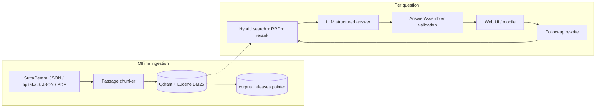

# Tripitaka RAG: study companion

Ask a question about the Pali Tripitaka. You get a detailed explanation grounded in **cited suttas**, a **mental-model diagram** of the teaching, and a small chart of where the passages came from. It's built with Spring Boot + Spring AI, and the hybrid retrieval.



## Status

| Part | State |
| --- | --- |
| SuttaCentral JSON ingestion (`SuttaCentralReader`, English) | implemented |
| tipitaka.lk JSON ingestion (`TipitakaLkReader`, Sinhala) | implemented |
| PDF ingestion (page = passage) | implemented, untested on real Tripitaka PDFs |
| Hybrid retrieval: Qdrant + BM25 + RRF, Cohere rerank (optional) | implemented, adapted from issue-investigator |
| Release publication (atomic switch, idempotent re-ingest) | implemented |
| Follow-up query rewrite with JDBC chat memory | implemented |
| Structured answer + citation validation + Mermaid mental model | implemented |
| Web UI (static, no build step) | implemented |
| Unit tests (no network) | 25 passing (`./mvnw verify`) |
| Live retrieval eval (`-Pevals`) | written, needs an ingested corpus |
| Auth, streaming, mobile app, Sinhala embeddings | next steps |

Qdrant: if issue-investigator's Qdrant is already running on 6333/6334, skip `docker compose up` and share it. This app uses its own collection, `tripitaka_chunks`.

## Get the texts

**English (recommended start).** SuttaCentral's [bilara-data](https://github.com/suttacentral/bilara-data) has segment-level JSON. Bhikkhu Sujato's translations are CC0.

```bash
git clone --depth 1 https://github.com/suttacentral/bilara-data.git ~/data/bilara-data
# texts live in ~/data/bilara-data/translation/en/sujato/sutta/{dn,mn,sn,an,kn}
```

**Sinhala / Pali (Buddha Jayanthi).** Use proofread Unicode text from [tipitaka.lk](https://pathnirvana.github.io/tipitaka.lk) instead of PDFs. Many Sinhala PDFs use legacy fonts that extract as garbage. Check the license before you publish an app. Before ingesting Sinhala, switch to a multilingual embedding model, re-ingest into a new Qdrant collection, and compare with the eval.

## Run

```bash
cp .env.example .env && export $(grep -v '^#' .env | xargs)   # needs OPENAI_API_KEY
docker compose up -d                                           # Qdrant

# 1) ingest (one time, exits when done). Start with one nikaya.
./mvnw spring-boot:run -Dspring-boot.run.profiles=ingest \
  -Dspring-boot.run.arguments="--format=suttacentral --path=$HOME/data/bilara-data/translation/en/sujato/sutta/mn"

# PDFs instead:
#   --format=pdf --path=/path/to/pdfs --nikaya="Majjhima Nikāya"

# 2) serve
./mvnw spring-boot:run      # http://localhost:8080
```

### Sinhala (separate page: http://localhost:8080/si.html)

The Sinhala page reads its own collection (`sutta-si`), so it never changes the English data. Text: Buddha Jayanthi
Tripitaka from [tipitaka.lk](https://github.com/pathnirvana/tipitaka.lk), CC BY-ND 4.0 (kept verbatim, attributed
on the page; check the license before publishing an app).

```bash
git clone --depth 1 --filter=blob:none --sparse https://github.com/pathnirvana/tipitaka.lk.git ~/data/tipitaka.lk
(cd ~/data/tipitaka.lk && git sparse-checkout set public/static/text)   # git pull later to stay in sync

TRIPITAKA_COLLECTION=sutta-si ./mvnw spring-boot:run -Dspring-boot.run.profiles=ingest \
  -Dspring-boot.run.arguments="--format=tipitakalk --path=$HOME/data/tipitaka.lk/public/static/text --include=dn-"
# --include takes file prefixes: dn-,mn-,sn-,an-,kn- (default: all five nikayas). Like English, each import replaces the
# Sinhala release, so list every nikaya you want in one run.
```

A note on ingestion: the whole collection is one release. To add another nikaya, point `--path` at the parent `sutta/` folder so the release contains everything. Ingesting only `sn` afterwards would publish a release with SN alone.

```bash
curl -s localhost:8080/api/ask -H 'Content-Type: application/json' \
  -d '{"question":"What are the four foundations of mindfulness?"}' | jq .

# follow-up in the same conversation
curl -s localhost:8080/api/ask -H 'Content-Type: application/json' \
  -d '{"question":"Explain the third one in more detail","conversationId":"<id from previous response>"}' | jq .
```

Response shape (shared by web and the future mobile client):

```json
{
  "conversationId": "…", "searchQuery": "…",
  "answer": "markdown…", "keyConcepts": ["sati", "…"],
  "citations": [{ "chunkId": "…", "textId": "mn10", "title": "Mindfulness Meditation",
                  "nikaya": "Majjhima Nikāya", "reference": "mn10:2.1 … mn10:3.4", "excerpt": "…" }],
  "mentalModel": { "type": "hierarchy", "title": "…", "nodes": [], "edges": [] },
  "mermaid": "flowchart TD …",
  "sourceDistribution": { "Majjhima Nikāya": 4, "Dīgha Nikāya": 2 },
  "unknowns": []
}
```

## Tests

```bash
./mvnw verify            # unit tests only, no network
./mvnw verify -Pevals    # + live retrieval eval (Qdrant + OPENAI_API_KEY + DN/MN/SN/AN ingested)
```

The eval runs 8 golden questions (MN 10, SN 56.11, MN 22, AN 3.65, …) and checks that an expected sutta appears in the retrieved passages. It reports the hit rate and fails below 70%.

## Design decisions (interview talking points)

1. **Chunk by passage, not by token count.** `PassageChunker` packs whole paragraphs (SuttaCentral, tipitaka.lk) or pages (PDF) into chunks of about 2,400 characters. A teaching stays together, and every chunk carries a real reference like `mn10:12.1 … mn10:14.3`, so citations point somewhere a reader can check.
2. **One release per collection.** issue-investigator published a generation per document. With about 5,000 suttas, that becomes a huge `IN (...)` filter on every query. Here the whole collection is hashed into one release. Both indexes are staged first, then a single SQL pointer switches. Re-running an unchanged ingest is a no-op. Chunk IDs include the release, so a new release never overwrites points that in-flight requests still read. The trade-off is that any change re-embeds the collection, which costs cents to a few dollars with text-embedding-3-small.
3. **Pali-aware BM25.** `StandardTokenizer + LowerCase + ASCIIFolding` makes "nibbana" match "nibbāna". Users search exact Pali terms where embeddings are weakest, which is why hybrid retrieval matters here.
4. **Follow-up rewrite.** Retrieval on "explain the third one" returns noise. A memory-free client rewrites the question into a standalone query using recent history, and falls back to the raw question on failure.
5. **Context out of memory.** Retrieved passages go in the system message, so chat memory holds only questions and answers, not thousands of tokens of scripture per turn.
6. **The model proposes, code decides.** `AnswerAssembler` drops citations that weren't retrieved in this request and builds citation metadata from the index, not from model output. It sanitizes the mental model before generating Mermaid. The source chart is counted from retrieval metadata, so no numbers come from the LLM.
7. **Diagram as data.** The API returns `nodes/edges` plus Mermaid. The web UI renders Mermaid now, and a mobile client can draw the same graph natively later.

## Known limits

- No auth: the server binds to `127.0.0.1` only. Add JWT (Spring Security resource server) before exposing it or building mobile.
- No streaming: the structured JSON answer arrives in one response (typically a few seconds).
- Retired releases are never garbage-collected from Qdrant or Lucene yet.
- PDF ingestion is page-based; it does not detect sutta boundaries.
- The UI loads Mermaid, marked and DOMPurify from jsDelivr. Vendor them for offline use.

## Next steps

1. Ingest MN, run `-Pevals`, and tune `rag.similarity-threshold` and `rag.answer-chunks` against the hit rate.
2. Add a faithfulness eval (port `FaithfulnessLiveTest` from issue-investigator).
3. Add JWT auth + CORS, then an Expo (React Native) client using the same `/api/ask` contract.
4. Sinhala: a multilingual embedding model, plus tipitaka.lk ingestion as a third reader.
